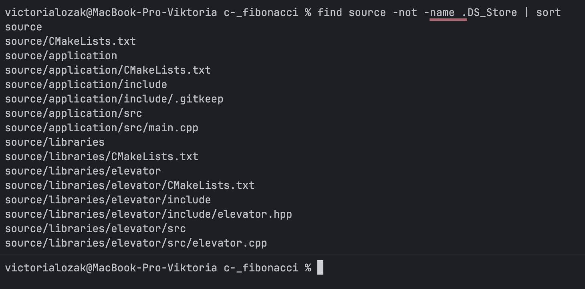
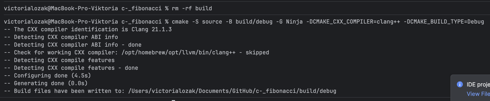
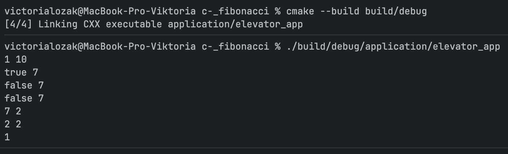
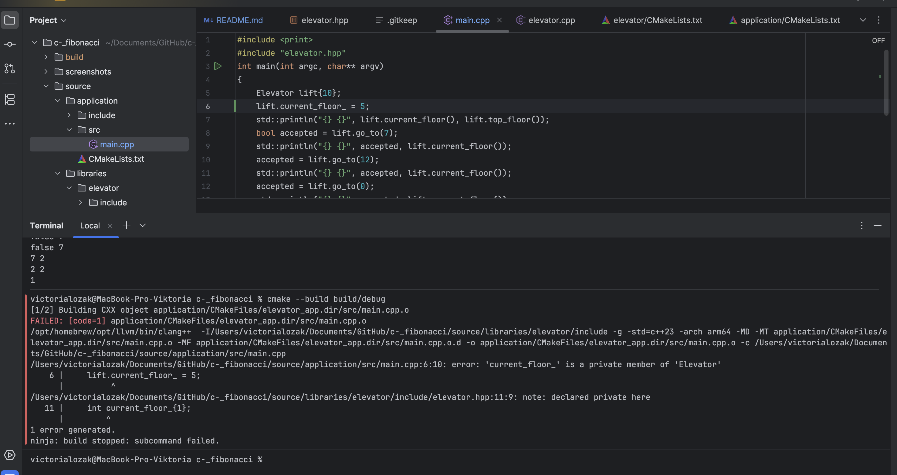
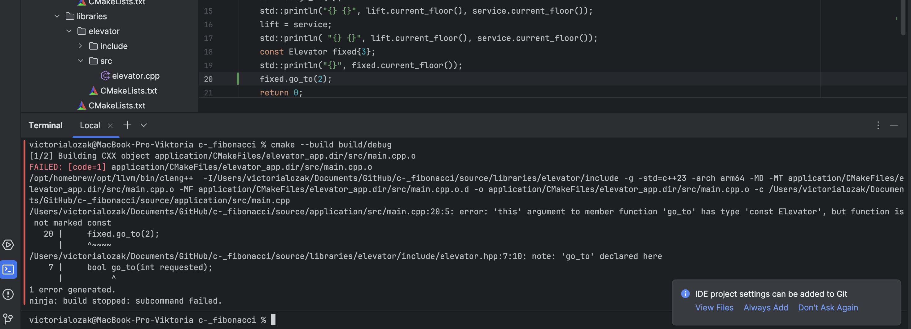
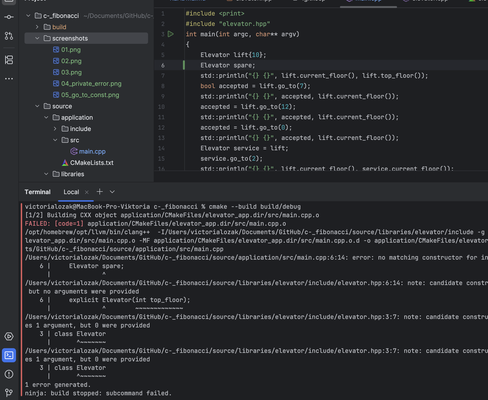
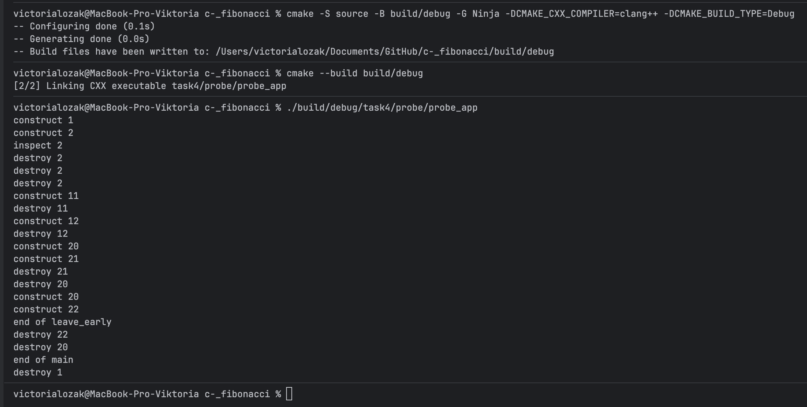

# Homework 4: Elevator class

Instead of Fibonacci, the project now contains an **Elevator** class.

**Tools:** Clang 21.1.3, C++23, CMake 4.1.1 (3.23+ required), Ninja.

> Fibonacci project from hw3 is still available on the `main` branch.
> All hw4 work is on the `homework_4` branch.

---

## Task 1

### What I did

1. Created a new branch `homework_4` 
2. Renamed `libraries/fibonacci` to `libraries/elevator` with `git mv`, and renamed the files to `elevator.cpp` / `elevator.hpp`.
3. Replaced the Fibonacci code with the Elevator code.
4. Renamed the targets: `fibonacci_lib` -> `elevator_lib`, `fibonacci_app` -> `elevator_app`.

### Layout

```
.git
build/
source/
    CMakeLists.txt
    application/
        CMakeLists.txt
        src/main.cpp
        include/               
    libraries/
        CMakeLists.txt
        elevator/
            CMakeLists.txt
            src/elevator.cpp
            include/elevator.hpp
```





---

## Task 2

### The header (`elevator.hpp`)

Copied from the assignment.

### The implementation (`elevator.cpp`)

Every function is written with its full name `Elevator::...`, which tells the compiler it belongs to the class.

```cpp
#include "elevator.hpp"

Elevator::Elevator(int top_floor)
    : top_floor_{top_floor}
{
}

bool Elevator::go_to(int requested)
{
    if (requested < 1 || requested > top_floor_)
        return false;

    current_floor_ = requested;
    return true;
}

int Elevator::current_floor() const
{
    return current_floor_;
}

int Elevator::top_floor() const
{
    return top_floor_;
}
```

### Build and run



The output matches the expected output.

## Task 3 

For each experiment I changed only `main.cpp`, rebuilt with the same command,
and then restored the original file. `elevator.hpp` and `elevator.cpp` were not changed.

### Experiment 1: writing to a private member



**Which access rule makes this invalid?**
`current_floor_` is declared in `private` section of class. Private members can only be used by the
class's own member functions. `main` is not a member of `Elevator`, so it is not allowed to read or write this field.

**Why is assigning to `current_floor_` inside `go_to` allowed?**
`go_to` is a member function of `Elevator` (`Elevator::go_to`), so it has access to the private data.
This is how class protects its invariant, only way to change the floor is through `go_to`, and `go_to`
checks floor first. If `main` could write `lift.current_floor_ = 5` directly, it could just as easily write
`= 99` and skip every check.

### Experiment 2: calling `go_to` on a const object



**What does the trailing `const` on `current_floor` allow?**
`fixed` is declared `const Elevator`, which means it must not be changed. On const object compiler only allows
calls to member functions marked `const`. `const` at the end of `int current_floor() const` is promise that 
function only reads the object. That is why `fixed.current_floor()` compiles and prints `1`.

**Why would the same declaration be unsuitable for `go_to`?**
`go_to` changes the object: it assigns new value to `current_floor_`. If it were marked `const`, compiler would
not let it modify `current_floor_`, so `elevator.cpp` would not compile. Function that moves the elevator cannot promise not to change it.

### Experiment 3: creating Elevator without arguments



**Why can't Elevator use an implicit default constructor?**
Default constructor is one that takes no arguments, like `Elevator()`. The compiler only generates it automatically
when the class declares **no constructors at all**. `Elevator` already declares `explicit Elevator(int top_floor)`,
so compiler does not add `Elevator()`. This makes sense: elevator without a known top floor is not meaningful,
so `Elevator spare;` should be error.

**Why don't the default member initializers `{1}` provide the missing constructor?**
`int current_floor_{1};` and `int top_floor_{1};` only say which value field gets **if a constructor does not set
it**. They are used *by* constructors. They do not *create* constructor. For example, my `Elevator(int)` does not
set `current_floor_`, so it uses `{1}`. "Which values the fields start with" and "how an object can be created" are two
different things, and only declared constructors decide second one.

## Task 4

### Adding the second program

I added `Probe` as a separate executable in its own folder, `source/task4/probe/`.

### My prediction
First, `one` is created, so `construct 1`. It belongs to `main`, so it should live until the end. In the inner block, `two` prints `construct 2`. `copy = two` makes copy with compiler's copy constructor, which prints nothing. Passing `copy` by value to `inspect` makes one more silent copy, then `inspect 2` is printed. When `inspect` returns, its parameter dies (`destroy 2`). At the end of the block, `copy` and then `two` die, in reverse order. So there is one `construct 2` but three `destroy 2`, because every copy runs same destructor.
Loop body is a new block on each iteration, so `item` is created and destroyed twice: 11, then 12.
In `leave_early(true)`, `first` (20) and `second` (21) are created, then `return` skips `third` and "end of leave_early" line, but the existing objects are still destroyed, newest first: 21, then 20.
In `leave_early(false)`, `if` is skipped, so 20 and 22 are created, "end of leave_early" is printed, and they are destroyed in reverse: 22, then 20.
Finally, "end of main" is printed and `one` is destroyed last.
So, we should get something like this:
```
construct 1
construct 2
inspect 2
destroy 2
destroy 2
destroy 2
construct 11
destroy 11
construct 12
destroy 12
construct 20
construct 21
destroy 21
destroy 20
construct 20
construct 22
end of leave_early
destroy 22
destroy 20
end of main
destroy 1
```

### Build and run

All my predictions were right.

#### Why `construct 2` appears once but `destroy 2` three times

Three different objects have id 2, but only `two` was created by `Probe(int id)`, the constructor that prints message.
`copy` was created by `Probe copy = two;`, and the parameter `probe` was created when `copy` was passed by value to `inspect`.
Both of these use **copy constructor**. `Probe` doesn't declare one, so compiler generated it automatically.
It copies `id_` but prints nothing. The destructor, however, is same `~Probe()` for every object, so all three print `destroy 2`.

#### Why the loop constructs and destroys on every iteration

Body of the `for` loop is block. Every iteration enters this block again, creates new `item`,
and leaves it at closing `}`. So `item` is new object each time (11, then 12),
and it is destroyed before the next iteration starts.

#### What happens in `leave_early(true)`

`first` (20) and `second` (21) are created. Then `return` leaves the function immediately,
so `Probe third{22};` and `std::println("end of leave_early");` are skipped, and `third` never exists.
Even though function ends early, the objects that already exist are still destroyed, newest first:
`second` (21), then `first` (20). `return` never skips destructors of objects that were already created.

## Task 5

**1. `Elevator service = lift;` vs `lift = service;`**

First line creates **new** object, `service`, as copy of `lift`. It uses **copy constructor**.
Second line does not create anything, both objects already exist, and `lift` just gets the values of `service`.
It uses the **copy assignment operator**, both operations are available because compiler generates them
automatically when class doesn't declare them. They simply copy every member, which is exactly right for two `int`s.

**2. Rejecting top floor below 1 in constructor**

Constructor has no return type, so it cannot return `false` like `go_to` does, and even if it could, object would still be created, just in a broken state.
Instead, constructor can **throw an exception**, for example `std::invalid_argument`, when `top_floor < 1`.
Then object is never created at all, so elevator that breaks invariant can never exist.

**3. Is `private` enough to keep invariant?**

No, `private` only stops code *outside* class from changing `current_floor_`.
Class's own functions can still set it to anything, so they must be written correctly.
In my code, invariant is protected by default value `current_floor_{1}`, so every elevator starts on floor 1,
and by check `if (requested < 1 || requested > top_floor_) return false;` in `go_to`,
which runs **before** `current_floor_ = requested;`.
If `go_to` assigned first and checked afterwards, invalid floor like 12 would already be stored.
Function would return `false`, but elevator would be on floor that doesn't exist.

**4. Elevator has no destructor. Is it still destroyed?**

Yes, when class doesn't declare a destructor, compiler generates one, and it runs when object's scope ends,
just like `~Probe()`. `Elevator` only holds two `int`s, so there is nothing to clean up.
Hand-written `~Elevator()` would add nothing useful, it would only matter if class owned resource,
like memory, file or connection, that must be released by hand(it could also print message, like `Probe` does)
