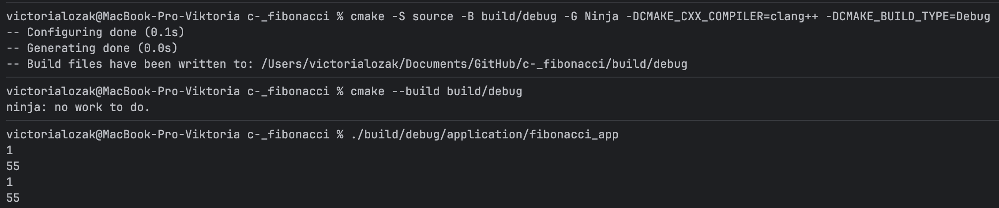
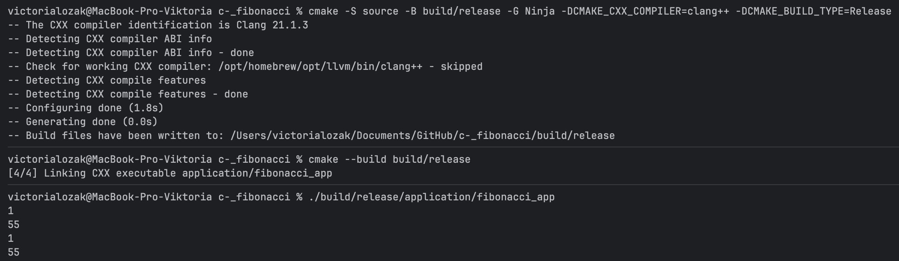
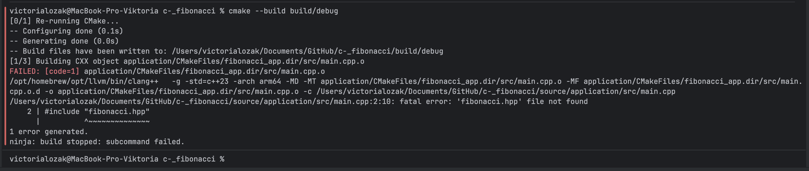
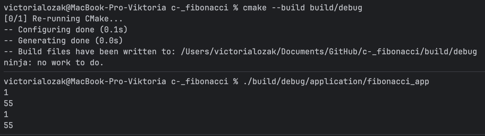

# Homework Assignment 3

**Tools used:** Clang 21.1.3, C++23, CMake 4.1.1 (3.23+ required), Ninja.

---

## Project layout

moved three source files from hw2 into this layout without changing them:

```
.git
build/                         <- everything CMake generates goes here (ignored by git)
source/
    CMakeLists.txt             <- the highest level, starts the project
    application/
        CMakeLists.txt         <- program (fibonacci_app)
        src/main.cpp
        include/               
    libraries/
        CMakeLists.txt         <- only says to go into fibonacci/
        fibonacci/
            CMakeLists.txt     <- library fibonacci_lib
            src/fibonacci.cpp
            include/fibonacci.hpp
```

I put CMakeLists.txt in every folder that contains something to build or leads to it; they are connected with add_subdirectory, so CMake could see them as one project:

`source/CMakeLists.txt`
```cmake
cmake_minimum_required(VERSION 3.23)
project(Fibonacci LANGUAGES CXX)

add_subdirectory(libraries)
add_subdirectory(application)
```

`source/libraries/CMakeLists.txt`
```cmake
add_subdirectory(fibonacci)
```

All commands are run from project root. `-S source` tells CMake where the sources are,
and `-B build/...` tells it where to put generated files.

### Adding directory does not replace linking a target

`add_subdirectory` makes targets visible, `target_link_libraries` connects them.

---

## Targets

`source/libraries/fibonacci/CMakeLists.txt`
```cmake
add_library(fibonacci_lib STATIC)

target_sources(fibonacci_lib PRIVATE src/fibonacci.cpp)
target_include_directories(fibonacci_lib PUBLIC include)
target_compile_features(fibonacci_lib PRIVATE cxx_std_23)
set_target_properties(fibonacci_lib PROPERTIES CXX_EXTENSIONS OFF)
```

`source/application/CMakeLists.txt`
```cmake
add_executable(fibonacci_app)

target_sources(fibonacci_app PRIVATE src/main.cpp)
target_compile_features(fibonacci_app PRIVATE cxx_std_23)
set_target_properties(fibonacci_app PROPERTIES CXX_EXTENSIONS OFF)
target_link_libraries(fibonacci_app PRIVATE fibonacci_lib)
```

## Header search path

`main.cpp` has `#include "fibonacci.hpp"`, so the compiler has to know where that file is.

Library says `target_include_directories(fibonacci_lib PUBLIC include)`.
Application has no include setting of its own, and there is no global `include_directories()`.
The application still gets `-I.../libraries/fibonacci/include`,
because it links to `fibonacci_lib` and receives library's public requirements.

### why the include path is PUBLIC while implementation sources and language are PRIVATE

- **PRIVATE** = *only I need this*
- **PUBLIC** = *I need this and everyone who uses this app needs it too*

## Build Debug and Release

Two separate build folders, both using Ninja and Clang.
Build type is chosen with `-DCMAKE_BUILD_TYPE`.

**Debug** (no optimization, with debug info -g):
```bash
cmake -S source -B build/debug -G Ninja -DCMAKE_CXX_COMPILER=clang++ -DCMAKE_BUILD_TYPE=Debug
cmake --build build/debug
./build/debug/application/fibonacci_app
```



**Release** (optimized, `-O3 -DNDEBUG`):
```bash
cmake -S source -B build/release -G Ninja -DCMAKE_CXX_COMPILER=clang++ -DCMAKE_BUILD_TYPE=Release
cmake --build build/release
./build/release/application/fibonacci_app
```



Both programs print the same output as hw2 app:
```
1
55
1
55
```

---

## Diagnose a missing requirement

In `source/libraries/fibonacci/CMakeLists.txt` I temporarily changed

```cmake
target_include_directories(fibonacci_lib PUBLIC include)
```
to
```cmake
target_include_directories(fibonacci_lib PRIVATE include)
```

and rebuilt the Debug project with `cmake --build build/debug`. Build failed:



Failed compilation of `main.cpp`, preprocessor step that handles `#include`.
Build never got to linking.

- `PRIVATE` means the path is used only when compiling the library itself.
  `fibonacci.cpp` is still compiled with `-I.../fibonacci/include`, so the library is fine.
  Its flags did not change, so Ninja did not even need to rebuild it.
- Path is no longer passed on to targets that link to the library.
  In failing command above there is no `-I...` at all, so compiler cannot find `fibonacci.hpp` for `main.cpp`.

**Fix:** changed `PRIVATE` back to `PUBLIC`, rebuilt, and ran the program again;I did not change any `#include` lines and did not add any extra include path.

```bash
cmake --build build/debug
./build/debug/application/fibonacci_app
```

